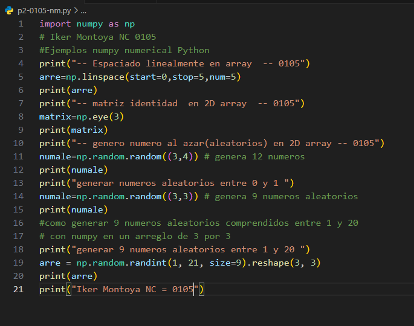
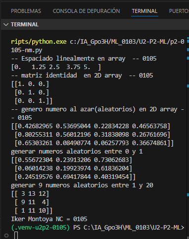

np.linspace(start=0,stop =1,num=5)
start=0: Valor inicial.

stop=1: Valor final.

num=5: Cantidad de números que se generan.

## que es arre = np.linspace

np.linspace es una función de NumPy que genera una cantidad determinada de números distribuidos uniformemente entre un valor inicial y uno final.

## el codigo 

## el resultado
